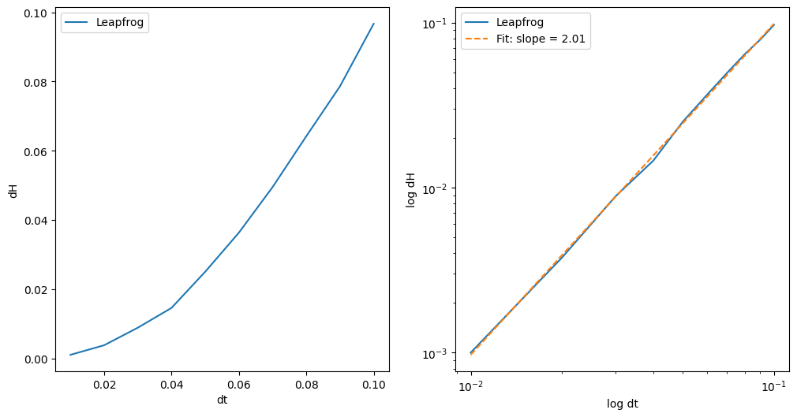
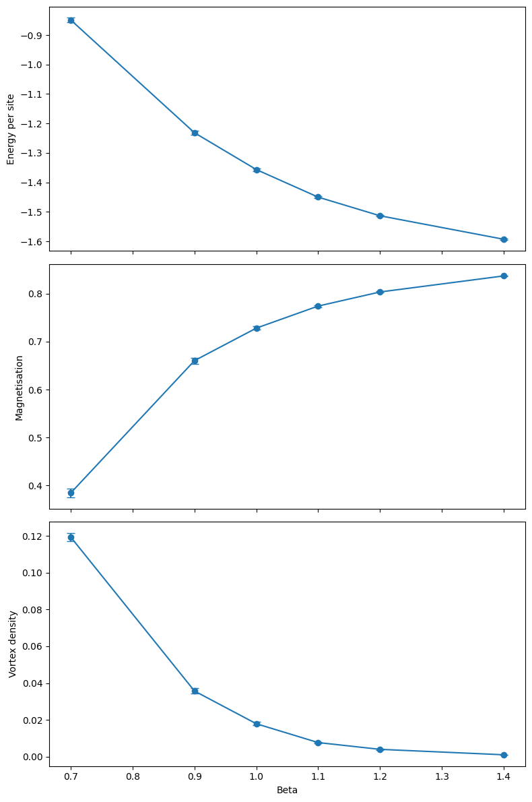
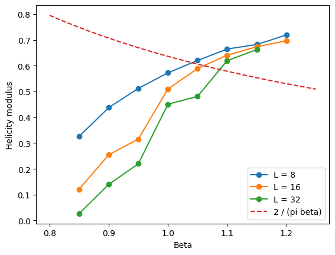

# Hamiltonian Monte Carlo for the 2D XY model

I wrote this code as part of my master project to investigate Monte Carlo sampling and critical behaviour in the 2D XY model, implementing Hamiltonian Monte Carlo and several physical observables from scratch in PyTorch. This code will later be used to generate training data for a diffusion based sampler.

## Model and implementation

Each site carries a planar spin $s_i=(\cos\theta_i,\sin\theta_i)$ on an
$L\times L$ square lattice with periodic boundaries. The energy is

$$E(\theta)=-J\sum_{\langle i,j\rangle}\cos(\theta_i-\theta_j),\qquad
p(\theta)\propto e^{-\beta E(\theta)}.$$

The code counts bonds in the two forward lattice directions, with $J=1$ in the
experiments and $\beta=1/T$ ($k_B=1$). HMC introduces Gaussian momenta and evolves
$H=\frac12\sum_i p_i^2+\beta E$ with a symmetric drift–kick–drift leapfrog integrator.
A momentum flip makes the proposal reversible, and a Metropolis test corrects the
integration error. Momenta are refreshed for each proposal. The force comes from
`torch.func.grad`; the integrator and sampling loop are implemented explicitly.

The measurements are energy per site, magnetisation magnitude per site, integer
plaquette vortex charges and their density, row/column winding numbers, and the
helicity modulus (response to a twist, estimated from ensemble bond sums).
Autocorrelation estimates give $N_\mathrm{eff}=N/(2\tau_\mathrm{int})$ and approximate
errors on the means. The longer scans compare $L=8,16,32$ around the BKT region.

## Numerical checks and saved figures

The notebook retains checks for aligned-state energy and magnetisation, global
rotation invariance, constructed vortices, zero total vortex charge on the torus,
known winding twists and leapfrog reversibility. Longer diagnostics compare hot
and cold starts and check the step-size dependence of the Hamiltonian error.
The saved reversibility errors are about $4.8\times10^{-7}$; the saved energy-error
fit has slope 2.006, consistent with second-order integration.

These figures were extracted directly from the original saved notebook outputs.
They were not recomputed during preparation for GitHub.



Mean $|\Delta H|$ at approximately fixed trajectory duration, with a log–log fit.



The $L=8$ scan: cooling increases finite-size magnetisation and suppresses vortices.
The plotted error bars use the notebook's autocorrelation-based estimates.



Helicity modulus compared with $2/(\pi\beta)$. This is an exploratory finite-size
comparison, not a precise determination of the transition temperature.

## Running it

Use Python 3.13 and a CPU environment. From the project directory:

```bash
python3 -m venv .venv
source .venv/bin/activate
python -m pip install -r requirements.txt
python -m jupyterlab XYmodel_metropolis.ipynb
```

Restart the kernel and run all cells with `RUN_LONG_EXPERIMENTS = False` (the default).
This runs the lightweight original assertions, a seeded $4\times4$ example
(20 thermalisation and 40 production proposals), and small input/reproducibility
checks. It is a demonstration, too short for physical conclusions. This default
path passed in a fresh Jupyter kernel (about six seconds on the preparation machine).
Short hot/cold runs also matched the original calculations exactly with identical
random draws.

Set `RUN_LONG_EXPERIMENTS = True` only to rerun the longer diagnostics and scans;
their original parameters are retained. All dependent plots are guarded too.
Skipped cells can still display their old saved outputs. Rerunning the notebook
cannot reconstruct the original raw measurement arrays from those images.

`SEED` controls future runs; each long section resets it with a separate offset.
`run_hmc(..., seed=...)` also allows a repeatable individual chain and resets the
global NumPy/PyTorch RNGs. The original outputs predate these seeds and are not
claimed to be exactly reproducible. Direct dependency versions for the preparation
checks are pinned; results can still differ across platforms or library versions.
Invalid controls, including `n_meas > n_iter` (no measurements), fail before sampling.

## Interpretation and limitations

Some observables like spin-spin correlation and heat capacity haven't been implemented yet. A sampler more suited to the XY model like Wolff needs to be included as a reliable benchmarking reference for a diffusion-based model.
